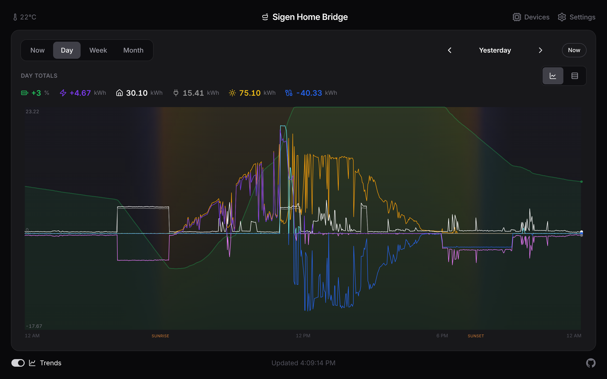

# Trends

The **Trends** switch in the lower left swaps the panels for a chart of every reading on one time axis, at its own `/trends` address. You get the power flows as lines, battery charge as a green area behind them, and a legend that totals each reading across the window you're looking at.

- **Scrub back in time.** Hover with a mouse, or press and drag on a touch screen. A cursor line snaps to the nearest reading and the legend, the clock, and the header temperature switch to that moment.
- **Read the sky.** The chart tints itself by the sun's height across the window, using your weather location, with sunrise and sunset marked on the axis. No internet calls; it's all worked out on the spot.
- **Solo a line.** Tap a reading in the legend to show just that one. Tap it again to bring them all back.
- **Pick a period.** A control in the top left switches between Now, Day, Week, and Month. Now shows a rolling window (1 minute to 24 hours; the short ones grey out when polling is slow). Day is one calendar day, Week is the last 7 days, and Month is one calendar month.
- **Step through history.** In Now, buttons below the chart walk the window back and forward, and Now returns to the live edge. In Day, Week, and Month, the arrows step a whole period and Now returns to the current one. On a keyboard, left and right step, and up and down move through the periods.
- **See daily energy.** Week and Month show one bar per day in kWh, up for import and charge, down for export and discharge. Scrub a bar to read that day, or tap it to open the day.
- **Split into lanes.** The icons beside the totals switch between Combined and Lanes. Lanes gives each series its own chart and scale, with a shared scrub line.
- **Rotate your phone.** In landscape on a touch phone, the page header and footer hide on Trends so the chart fills the screen; the Trends switch at the top left closes it.

Your history survives restarts; it's kept in a small database on the host. The chart remembers your period, layout, and hidden lines. How far back it can reach (31 to 90 days) is set under **Settings → History**, where you can also download the readings as CSV or JSON, at full detail or thinned to one row a minute.
